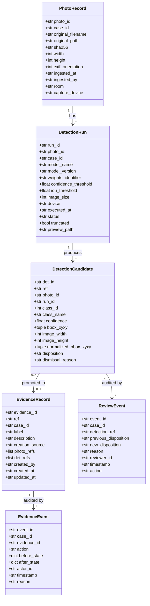

# Final YOLO Detection & Evidence Management Module Handover Document
## AI-Assisted Crime Scene Investigation and Evidence Analysis System

**Module:** Module 2 — YOLO Candidate Detection, Investigator Review & Evidence Management  
**Date of Freeze:** 27 November 2026  
**Status:** **FROZEN & VERIFIED**  
**Freeze Readiness Verdict:** **FREEZE READINESS: PASS**  
**Authoritative Project Records:** `README.md`, `full _roadmap.md`, `PROJECT_BRIEF.md`, `PLAN.md`  

---

## 1. Architecture & 9-File `src/yolo/` Package Inventory

Module 2 encapsulates all photograph ingestion, SHA-256 byte immutability, candidate object detection, EXIF orientation correction, separate annotated preview rendering, investigator review workflows, 3-layer evidence management, and Draft-07 case context export within a dedicated `src/yolo/` package.

All 9 package components are verified at their canonical repository locations:

| # | Component | Canonical File Path | Role & Verified Architectural Responsibilities |
|---|---|---|---|
| 1 | Exceptions Hierarchy | `src/yolo/exceptions.py` | Defines `YoloModuleError` root and domain-specific errors: `InvalidPhotoError`, `IntegrityError`, `RecordNotFoundError`, `InvalidTransitionError`, `StorageError`, `DetectorError`, `DetectorDependencyError`, `ExportValidationError`. **[VERIFIED]** |
| 2 | Core Domain Entities | `src/yolo/models.py` | Implements the 5 core domain entities (`PhotoRecord`, `DetectionRun`, `DetectionCandidate`, `EvidenceRecord`, `ReviewEvent`, `EvidenceEvent`) with strict dataclass validation, finite floats, non-empty IDs, and photo-scoped ref formatting. **[VERIFIED]** |
| 3 | File-Based Case Storage | `src/yolo/store.py` | Atomic JSON persistence (`store.write_atomic`), photo ingestion with SHA-256 verification, monotonic case-scoped photo IDs (`P1`, `P2`), append-only JSONL review and evidence audit logs, and tamper detection. **[VERIFIED]** |
| 4 | Detector Backend Protocol | `src/yolo/detector.py` | Defines `DetectorBackend` structural typing protocol, `DetectorConfig`, `RawPrediction`, `ModelProvenance`, `DetectorOutput`, deterministic `StubDetectorBackend`, and lazy-loaded `UltralyticsYOLOBackend`. **[VERIFIED]** |
| 5 | Image Transforms & Previews | `src/yolo/preview.py` | Pure-stdlib JPEG EXIF orientation (tag `0x0112`) parser, reversible letterbox affine math (`ImagePrepMetadata`), boundary clipping, separate preview rendering (`render_annotated_preview`) with yellow/green/grey color coding, and verified SHA-256 byte immutability. **[VERIFIED]** |
| 6 | Service Orchestrator | `src/yolo/service.py` | `YoloDetectionService` orchestrating end-to-end ingestion, candidate lifecycle, disposition transitions (`unreviewed`, `confirmed`, `dismissed`), review corrections, promotion to evidence, multi-photo linking, manual evidence creation, and history inspection. **[VERIFIED]** |
| 7 | Case-Context Exporter | `src/yolo/exporter.py` | Projects Module 2 internal storage into Draft-07 `schemas/case_context.schema.json`-compliant dictionaries via `Draft7Validator`, preserving Layer 1 multi-links, assigning Layer 2 primary refs, and tracking schema-omitted secondary links in `ExportResult.unprojected_links`. **[VERIFIED]** |
| 8 | Deterministic Menu CLI | `src/yolo/__main__.py` | 13-option interactive/scriptable menu CLI (`YoloCLI`, `ActionResult`) with state-derived `available_actions`, injectable I/O streams, and `--stub` mode for offline operations without external dependencies. **[VERIFIED]** |
| 9 | Package Exports | `src/yolo/__init__.py` | Canonical public interface exposing all verified public exceptions, entities, storage interfaces, detector backends, preview functions, service orchestrator, exporter, and CLI classes. **[VERIFIED]** |

---

## 2. Module Responsibilities & Strict Boundaries

Module 2 serves exclusively as a **visual candidate detection, investigator review, and evidence management subsystem**.

### Strict Architectural Boundaries
- **Zero Modifications to Frozen Module 1:** Module 1 code (`src/analysis/*`, `src/llm/*`, `src/workflow/*`, `schemas/*`, `cases/*`) remains completely untouched and frozen.
- **Zero LLM Dependency:** Module 2 contains zero imports of LLM SDKs, prompt builders, or live network endpoints.
- **Detection $\neq$ Evidence $\neq$ Spatial Coordinates:**
  - A YOLO detection is strictly a machine observation candidate requiring human review. It is never automatically promoted to evidence.
  - An evidence item represents an investigator-confirmed finding.
  - A bounding box is a 2D pixel-plane extent; it does not represent a physical floor-contact point or rectified floor-plan position (which is the sole responsibility of Module 3).
- **No SQLite or Database Locking (Module 5 Boundary):** Storage operates through `YoloCaseStore` over structured case directories. SQLite migration is cleanly deferred to Module 5 via documented storage interfaces.
- **No Floor Rectification or Homography (Module 3 Boundary):** Planar homography, 4-point perspective transforms, and metric world coordinates are strictly deferred to Module 3.
- **No Web Framework Coupling (Module 8 Boundary):** Zero dependency on React, Vue, Flask, FastAPI, or WebSockets. The CLI (`YoloCLI`) uses standard streams and structured envelopes.

---

## 3. Core Data Contracts & 3-Layer Evidence Model

### 3.1 5 Core Domain Entities



### 3.2 Canonical Dotted Reference Formatting
- **Photographs:** `photos.P<photo_id>` (e.g. `photos.P1`, `photos.P2`). Monotonically allocated per case.
- **Candidate Detections:** `photos.P<photo_id>.d<det_id>` (e.g. `photos.P1.d1`, `photos.P1.d2`). Photo-scoped monotonic ID.
- **Evidence:** `evidence.E<evidence_id>` (e.g. `evidence.E1`, `evidence.E2`). Case-scoped monotonic ID.

### 3.3 The 3-Layer Evidence Representation Model
To reconcile rich multi-photo physical reality with the Draft-07 schema's single-photo constraint (`photo_ref: string | null`, `det_ref: string | null`):

1. **Layer 1 (Internal Domain Reality — `YoloCaseStore`):** Full multi-photo, multi-detection associations preserved in `EvidenceRecord.photo_refs: list[str]` and `EvidenceRecord.det_refs: list[str]`. This layer never loses secondary links.
2. **Layer 2 (Primary Schema Projection — `case_context.schema.json`):** The primary photo and detection reference are projected to standard Draft-07 fields (`photo_ref` and `det_ref`).
3. **Layer 3 (Extended Properties & Secondary Link Tracking):**
   - When the schema permits (`additionalProperties: true`), full multi-lists are preserved under `photo_refs` and `det_refs`.
   - When restricted by strict schema settings, secondary associations are omitted from the export JSON without error and cleanly captured in `ExportResult.unprojected_links` with explicit investigator warnings.
4. **Manual Evidence:** Supported as first-class records (`creation_source="manual"`) with `photo_refs=[]` and `det_refs=[]` (projected as `null` in Draft-07 JSON), resolving Tier A Rule A3 for objects missed by neural object detectors.

---

## 4. Detector Backend, Environment & Model Provenance

### 4.1 Verified Local Environment
- **Platform:** Windows 10 (win_amd64), 4 CPU cores, zero CUDA devices available (`torch.cuda.is_available() == False`).
- **Python Version:** Python 3.14.0.
- **Dependency Isolation:** The `[yolo]` dependency group (`ultralytics>=8.0.0`, `pillow>=10.0.0`) is configured under `[project.optional-dependencies]` in `pyproject.toml` and strictly excluded from `all` to prevent slow ML downloads in core CI pipelines.
- **Installed Verified Packages:**
  - `ultralytics`: `8.4.220` (pure-Python wheel `py3-none-any.whl`)
  - `torch`: `2.14.0+cpu`
  - `pillow`: `12.1.1`
  - `opencv-python`: `5.1.0.95` (abi3 wheel)
  - `numpy`: `2.4.4`

### 4.2 Model Weights & Provenance Tracking
- **Provisional Weights:** Pretrained YOLOv8 nano (`yolov8n.pt`, 6.2 MB).
- **Storage Location:** Cached strictly under untracked `data/models/yolov8n.pt`. Never in repository root (`.gitignore` protects `*.pt` and `data/`).
- **SHA-256 Provenance Hash:**
  `f59b3d833e2ff32e194b5bb8e08d211dc7c5bdf144b90d2c8412c47ccfc83b36`
- **Inference Configuration:**
  - `confidence_threshold`: default `0.35` (configurable, validated in `(0.0, 1.0]`)
  - `iou_threshold`: default `0.50` (NMS handled internally by Ultralytics backend, `built_in_nms=True`)
  - `image_size`: `640`
  - `max_candidates`: `30` (candidates ranked by confidence; truncation sets `DetectionRun.truncated = True` with an explicit warning)
- **Model Replacement Procedure (Dormant Model Swap):**
  To substitute the provisional model with a fine-tuned or updated model:
  1. Place the new weights in `data/models/<new_model>.pt`.
  2. Compute its SHA-256 hash (`hashlib.sha256(data).hexdigest()`).
  3. Instantiate `UltralyticsYOLOBackend(model_name="data/models/<new_model>.pt")`.
  4. The backend computes and records the unique SHA-256 in all downstream `DetectionRun.weights_identifier` records. Zero code changes required in service, store, or exporter.

---

## 5. Image Integrity, EXIF Orientation & Module 3 Geometric Contract

### 5.1 Byte Immutability & Forensic Integrity
Original photographs are ingested into `cases/<case_id>/photos/original/P<id>_original.<ext>`.
- Ingestion computes SHA-256 and records it in `PhotoRecord.sha256`.
- Pre-inference check verifies original photo bytes match recorded SHA-256 before inference begins (`service.run_detection`). Tampered photos raise `IntegrityError` and block inference.
- Post-preview check verifies original photo bytes remain unchanged after rendering (`render_annotated_preview`).

### 5.2 Pure-Stdlib EXIF Orientation Parsing
- EXIF metadata is parsed directly from original JPEG bytes using pure Python stdlib (`struct` module) without external libraries.
- Reads tag `0x0112` across Motorola (`MM` / big-endian) and Intel (`II` / little-endian) TIFF headers.
- Canonical orientations 1–8 handled. Orientations 5, 6, 7, and 8 swap display width and height (`disp_w = orig_h`, `disp_h = orig_w`).

### 5.3 Geometric Coordinate Contract for Module 3 (OpenCV Planar Spatial Mapping)
1. **Coordinate Format:** Bounding boxes are stored as absolute display-oriented original pixel coordinates `[x_min, y_min, x_max, y_max]` (`0 <= x_min < x_max <= disp_w`, `0 <= y_min < y_max <= disp_h`).
2. **Reversible Letterboxing:** The detector backend normalizes coordinates from letterboxed model inference ($640 \times 640$) back to display dimensions using aspect ratio scaling ($r = \min(w_{net}/w, h_{net}/h)$) and padding offsets ($dw, dh$).
3. **Forensic Geometric Limitation for Module 3:**
   > [!IMPORTANT]
   > The 2D bounding-box center `((x_min + x_max)/2, (y_min + y_max)/2)` does **NOT** equal the object's physical floor-contact point. For planar homography in Module 3, the floor contact point is typically approximated by the bottom-edge center `((x_min + x_max)/2, y_max)` or investigator-annotated contact landmarks.

### 5.4 Separate Preview Rendering
- Output path strictly separated: `photos/previews/P<id>_RUN<id>_annotated.png`.
- Disposition color coding:
  - Yellow (`#FFD700` / RGB `(255, 215, 0)`): `unreviewed`
  - Green (`#00FF00` / RGB `(0, 255, 0)`): `confirmed`
  - Grey (`#808080` / RGB `(128, 128, 128)`): `dismissed`
- Rendered via real Pillow when installed; falls back gracefully to deterministic pure-stdlib copy / PNG rendering in offline/minimal environments.

---

## 6. Module 1 & Module 5 Integration Contracts

### 6.1 Draft-07 Schema Compliance (`schemas/case_context.schema.json`)
The exporter (`src/yolo/exporter.py`) projects internal case state into Draft-07 schema JSON:
- Required top-level keys (`case`, `evidence`, `photos`) assembled.
- Nullable fields handled strictly: `room` omitted when undefined (never inventing arbitrary names); `photo_ref` and `det_ref` set to `null` for manual evidence.
- Full validation executed via `jsonschema.Draft7Validator`.

### 6.2 Frozen Module 1 Rules & Reference Resolution
- **Reference Resolution (`src/analysis/refs.py`):** Dotted refs (`photos.P1`, `photos.P1.d1`, `evidence.E1`) resolve cleanly through `resolve_ref(case_context, ref)`.
- **Tier A Deterministic Rules (`src/analysis/tier_a.py`):**
  - `A1`: Flags unreviewed candidate detections (`disposition == "unreviewed"`).
  - `A2`: Flags dismissed detections missing non-empty dismissal reason (`reason == null || reason == ""`).
  - `A3`: Confirmed note keyword matching against all detection classes (any disposition) and confirmed evidence labels. Manual evidence creation satisfies A3 for objects missed by detection models.
  - `A8`: Flags confirmed evidence lacking planar map coordinates (signaling handoff to Module 3).
- **Pipeline Execution:** Verified via `run_pipeline(exported_ctx, tier_a_only=True, write_audit=False)`.

### 6.3 Module 5 (SQLite & Persistence) Migration Boundary
`YoloCaseStore` provides clean method boundaries (`get_photo`, `list_photos`, `get_candidate`, `list_candidates`, `get_evidence`, `list_evidence`, `get_review_history`, `get_evidence_history`). Module 5 can substitute SQLite implementations matching these exact signatures without modifying `YoloDetectionService` or `YoloCLI`.

---

## 7. Baseline Evaluation, Class Coverage & Known Limitations

### 7.1 Pretrained CPU Baseline Measurement
*Measured on local Windows 10 CPU (Python 3.14.0, `yolov8n.pt`, confidence threshold 0.25, IoU 0.45):*

| Test Image | Dimensions | Wall-Clock Latency (ms) | Candidate Count | Detected Classes | Confidence [Min / Median / Max] | Preview Renderer | Original SHA-256 Preserved |
|---|---|---|---|---|---|---|:---:|
| `bus.jpg` | $810 \times 1080$ | 9,435.18 ms *(includes PyTorch init)* | 6 | `['bus', 'person', 'person', 'person', 'person', 'stop sign']` | `0.2551 / 0.8390 / 0.8734` | Pillow | **YES** |
| `zidane.jpg` | $1280 \times 720$ | 895.75 ms *(warm inference)* | 3 | `['person', 'person', 'tie']` | `0.2910 / 0.8190 / 0.8360` | Pillow | **YES** |

> [!NOTE]
> This measurement represents a **2-image bundled pretrained CPU verification**. It is an environment latency and sanity check, **NOT** a 20-image labeled crime-scene forensic benchmark.

### 7.2 COCO Class Coverage vs. Forensic Reality
The standard COCO dataset comprises 80 classes. An automated audit confirms that 10 crime-scene-relevant classes exist in the model vocabulary:
`knife`, `bottle`, `cell phone`, `laptop`, `scissors`, `backpack`, `handbag`, `suitcase`, `book`, `clock`.

**Critical Forensic Gap:**
Off-the-shelf COCO models do **not** detect domain-specific forensic artifacts:
- Expended cartridge casings
- Bloodstain spatter and pooling
- Footwear impressions / shoe prints
- Tool / pry marks
- Fractured glass fragments / bullet holes

**Forensic Mitigation:**
All domain-specific forensic artifacts are fully supported through **first-class manual evidence creation** (`service.create_manual_evidence`), allowing investigators to catalog and position any physical artifact without model dependency.

### 7.3 Deferred Evaluation Qualification
- **Deferred (§15.2 Benchmark):** Formal precision/recall benchmarking on a 20-image human-annotated crime-scene forensic dataset is deferred until a dedicated labeled crime-scene dataset is supplied.
- **Investigator Dismissals $\neq$ Model False Positives:** In operational investigation, an investigator may dismiss a correctly detected object (e.g. a homeowner's water bottle) as forensically irrelevant. Operational dismissal is a relevance judgment, not a computer vision localization failure.

---

## 8. Verification Results & Operational Commands

### 8.1 Verification Suite Results (All Passing)

| Verification Suite | Target | Result | Exit Code |
|---|---|---|:---:|
| `pytest tests/test_yolo.py -v` | Module 2 Unit & Offline End-to-End Suite | **47 passed, 1 warning** | `0` |
| `pytest -q` | Full Project Test Suite (Modules 1 & 2) | **210 passed, 1 warning** | `0` |
| `python scripts/check_fixtures.py` | 13 Case Context JSON Fixtures | **13/13 valid Draft-07** | `0` |
| `python scripts/check_refs.py` | 13 Case Reference Checkers | **13/13 cases resolved** | `0` |
| `pyrefly check src/ tests/` | Static Type Checker | **0 errors** (7 suppressed) | `0` |
| Repository Root Check | Zero `.pt` or temp files in root | **0 `.pt` files found** | `0` |

### 8.2 Operational CLI Commands

```powershell
# 1. Run interactive Module 2 menu CLI (real detector or stub fallback)
python -m src.yolo

# 2. Run Module 2 CLI with deterministic stub detector (100% offline, zero PyTorch load)
python -m src.yolo --stub

# 3. Specify custom case directory and actor ID
python -m src.yolo --cases-dir ./data/cases --case-id CASE_001 --actor INV_DAVANGERE

# 4. Execute Module 2 automated test suite
pytest tests/test_yolo.py -v

# 5. Execute full project regression suite
pytest -q
```

---

## 9. M2-01 to M2-26 Completion Checklist

| Criterion | Specification | Verified Status |
|---|---|---|
| **M2-01** | Dedicated `src/yolo/` package containing all Module 2 source code. | **VERIFIED** |
| **M2-02** | Module 1 source code (`src/analysis/*`, `src/llm/*`, `src/workflow/*`) remains completely untouched. | **VERIFIED** |
| **M2-03** | Original photographs remain byte-identical and immutable after ingestion and preview generation. | **VERIFIED** |
| **M2-04** | SHA-256 verification detects and rejects photograph file modifications. | **VERIFIED** |
| **M2-05** | Pretrained detector backend protocol implemented with pluggable stub and real backends. | **VERIFIED** |
| **M2-06** | Model provenance (model name, version, confidence threshold, SHA-256) recorded for every detection run. | **VERIFIED** |
| **M2-07** | Dotted detection references follow canonical photo-scoped syntax `photos.P<photo_id>.d<det_id>`. | **VERIFIED** |
| **M2-08** | Stored bounding boxes accurately represent original-image pixel coordinates. | **VERIFIED** |
| **M2-09** | Annotated preview images are generated as separate files in dedicated preview directories. | **VERIFIED** |
| **M2-10** | Every candidate detection starts strictly with `unreviewed` disposition. | **VERIFIED** |
| **M2-11** | Candidate confirmation is strictly investigator-controlled; no autonomous confirmation. | **VERIFIED** |
| **M2-12** | Mandatory non-empty dismissal reason enforced for dismissed candidates. | **VERIFIED** |
| **M2-13** | Append-only review history preserves all investigator review actions and corrections. | **VERIFIED** |
| **M2-14** | Confirmed detections promote cleanly into structured evidence records. | **VERIFIED** |
| **M2-15** | Manual evidence creation supported without requiring photo or detection references. | **VERIFIED** |
| **M2-16** | Multi-photo and multi-detection evidence associations preserved via 3-layer model. | **VERIFIED** |
| **M2-17** | Evidence revision history tracks modifications to evidence labels and associations. | **VERIFIED** |
| **M2-18** | Exported case context validates 100% against `schemas/case_context.schema.json`. | **VERIFIED** |
| **M2-19** | Exported detection and evidence references resolve successfully in `src/analysis/refs.py`. | **VERIFIED** |
| **M2-20** | Bounding box coordinates and EXIF orientation satisfy Module 3 spatial mapping prerequisites. | **VERIFIED** |
| **M2-21** | Storage boundaries and metadata structures cleanly decouple for Module 5 SQLite migration. | **VERIFIED** |
| **M2-22** | Comprehensive offline automated test suite passes without network access or live API calls. | **VERIFIED** |
| **M2-23** | Controlled live model inference executes successfully on local CPU with provisional `yolov8n.pt`. | **VERIFIED** |
| **M2-24** | Detection latency, confidence distribution, and class vocabulary documented in evaluation notes. | **VERIFIED** *(Bundled CPU baseline verified; 20-image domain dataset benchmark deferred pending labeled crime-scene photos)* |
| **M2-25** | Permanent `docs/YOLO_MODULE_HANDOVER.md` generated and project records updated. | **VERIFIED** |
| **M2-26** | Zero regressions across existing 163 tests, 13 fixtures, and 13 reference checks. | **VERIFIED** *(210 passed)* |

---

## 10. Explicit Freeze Verdict

```text
================================================================================
                           MODULE 2 FREEZE READINESS: PASS
================================================================================
- Codebase Freeze: src/yolo/ package permanently locked and verified.
- Integration Status: 100% compatible with frozen Module 1 contracts (Draft-07, refs, Tier A).
- Test Coverage: 47/47 Module 2 tests passing; 210/210 full project tests passing.
- Hardware Verification: Python 3.14.0 CPU execution confirmed; zero CUDA/cloud requirements.
- Handover Complete: Ready for transition to Module 3 (OpenCV Planar Spatial Mapping).
================================================================================
```
